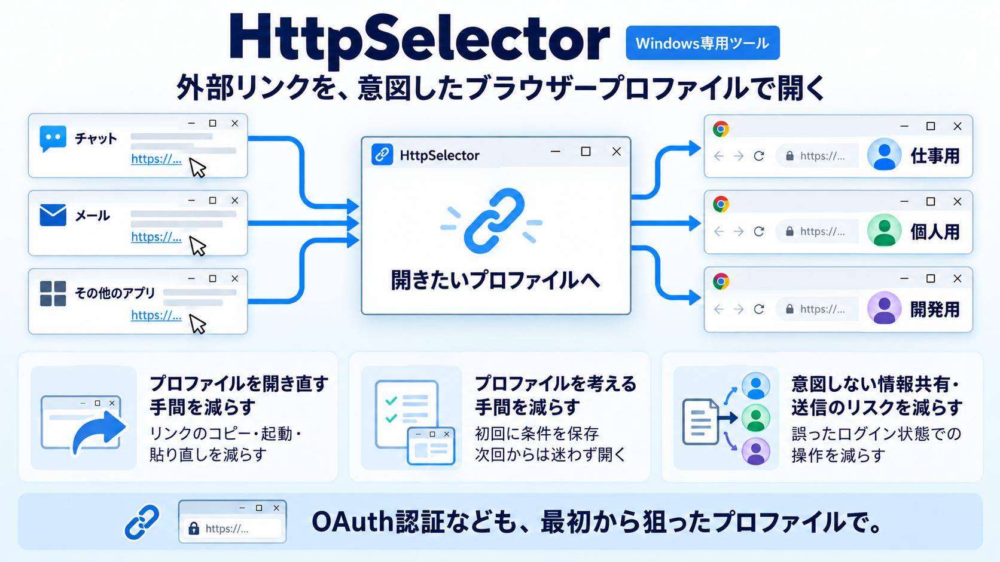

# HttpSelector

チャット、メール、その他のアプリから開いたHTTP/HTTPSリンクを、意図したブラウザー・プロファイルへ渡すWindows用ツールです。URLのルールで自動振り分けするか、その場でプロファイルを選択できます。

## 解決する課題

WindowsでChromeやEdgeを使う際、外部アプリから開いたリンクが、最後にアクティブだったプロファイルなど、意図しないプロファイルで開かれることがあります。仕事用・個人用・別組織用を使い分けている場合、適切なプロファイルでリンクを開き直す手間が生じます。

HttpSelectorは、リンクを最初から狙ったプロファイルで開くことで、次の問題を減らします。

- **誤ったプロファイルでのログイン・認証**：OAuth認証フローなどで一度しか使えないワンタイムURLを扱う際、意図しないプロファイルで先に開いてしまうことを防ぎます。使い切ったURLでは、後から正しいプロファイルで操作をやり直せない場合があります。
- **プロファイルを開き直す手間**：リンクのコピー、別プロファイルの起動、貼り直しといった作業を減らします。
- **意図しない情報共有やリクエスト送信**：誤ったプロファイルのログイン状態を使い、意図しない相手・組織へ情報を共有したり、不適切なリクエストを送ったりするリスクを減らします。

アカウントの認証やアクセス権を代行・保証する機能はありません。高リスクURLの警告は、リンクを開く入口で適切なプロファイルを選ぶための補助機能です。

## 基本機能

- OSの既定のブラウザに本ツールを割り当てて使用します。
- 各種アプリでURLを開いたとき、まずは本ツールが起動します。
- PCに導入されたブラウザ（Edge、Chrome、Firefox）のプロファイルを検出してアイコンを列挙するので、その中から開きたいプロファイルを選択して開きます。
- URLのドメイン・パス・クエリの組み合わせを保存できます。以後は自動で関連付けたプロファイルで開きます。
- URLをデコードしてパラメータに書かれている日本語文字を確認できます。
- ルールベースで大手サービス名の誤字や偽装ドメインなどを検査し開く前に警告します。

## 機能補足

- ブラウザーへ渡す元URLはそのまま転送します。途中で改変は行いません。
- プロファイルのお気に入り、表示名、コメント、並び順を設定できます。
- パラメーター内にURLが含まれる場合は、内側のURLの条件も選択できます。
- 関連付けの条件は正規表現で保存されます。
- 登録済みリンクでもShiftを押しながら開くと、プロファイルを選び直せます。
- 「割り込み」をOFFにすると質問を抑制できます。保存ルールを優先し、未一致の場合はお気に入り先頭プロファイルで開きます。（Shiftで開くと設定表示は可能）
- KotorinToysからの無表示起動、状態取得、画面表示、正常停止に対応します。

## 利用時の注意

**導入直後は確認が頻繁に表示され、リンクを開く際の操作がおよそ2クリック増えます。** プロファイルを選び、確認フォームで「開く」を押す流れです。実際の回数はダブルクリックなどの操作設定や登録ルールによって変わります。

よく使う条件を登録すると、自動振り分けで確認を減らせます。安全性の警告や、Shiftによる意図的な選び直しは省略しません。

## 保存する情報

URLのパラメーターには認証コード、一時トークン、個人情報などの機密情報が含まれる可能性があります。**保存する情報は振り分けに必要な最小限となるようにしています。** ドメインや安定したパスなど、目的を満たす最小限の条件を選んでください。

部分選択のルールでは、ONにしたドメイン・パス・クエリの名前と値、生成した正規表現、次回の動作を端末内へ保存します。選択した値に機密情報が含まれる場合、その値も保存されます。手入力した既存形式のルールは入力内容をそのまま保存します。

URLパターンの自動記録は既定OFFです。有効にした場合は末尾パス・パラメーター値・フラグメントを `*` に置換しますが、完全な匿名化ではありません。設定DBにはHMAC-SHA256による完全性チェックを付け、検証用の鍵をWindows DPAPIで保護します。DBの内容自体は暗号化していません。

## URLのリスク確認と外部送信

端末内で、全角英字、類似文字、大手サービス名の誤字や偽装ドメインなどを検査します。承認済みの完全一致ドメインでは名称偽装の警告だけを抑制し、他の検査は維持します。

**Quad9への照会は既定OFFです。** 利用者が「設定」で「Quad9へドメインを照会する（既定OFF）」をONにして保存した場合だけ、外側と検査対象の内側URLのドメインをDNS over HTTPSで送信します。OFFにして保存すると以後の照会を停止します。OFFでも端末内の検査は継続し、外部照会をしないことを理由とした警告は表示しません。

送信するのはサブドメインを含むASCIIホスト名とDNS問い合わせに必要な情報です。元URL、認証情報、ポート、パス、クエリ、フラグメントは送りません。ただし、送信先には接続元IPなどの通信情報が伝わります。ONの場合、警告画面でキャンセルする前に照会が行われることがあります。WindowsのDNS設定は変更しません。

危険性が疑われる場合や、有効にした外部照会を確認できない場合は、開く前に警告します。「それでも開く」を明示的に選ぶまで、ブラウザー起動、関連付け追加、自動履歴記録を行いません。警告がないことは安全保証ではありません。対象ページの取得、短縮URLの展開、リダイレクト追跡は行いません。

## 導入と配布

本ツールはWindowsのHTTP/HTTPSリンクの受付に介在します。認証用URLなども扱う入口であるため、発行元と配布物の改ざんの有無を確認できることを重視し、**通常利用は署名付きMSIXからのインストールを必須**としています。これは本ツールの配布方針です。署名はリンク先の安全性を保証しません。

[MSIX導入手順](docs/INSTALL_MSIX.md)に従って発行元と証明書の拇印を確認し、Windowsの既定のアプリ設定でHTTP/HTTPSをHttpSelectorへ関連付けてください。既定アプリを自動変更することはありません。

[GitHub Releases](https://github.com/KotorinChunChun/HttpSelector/releases/latest)からMSIXを取得できます。導入と自動更新用のApp Installerは[公開サイト](https://excel-chunchun.sakura.ne.jp/download/HttpSelector.html)から取得できます。**正式版はMicrosoft Storeへの掲載を予定しています。**

## 対応環境と詳細

Windows 10 1809以降 / Windows 11、x64。

[利用ガイド](docs/USERS_GUIDE.md) ／ [よくある質問](docs/FAQ.md) ／ [プライバシーポリシー案](docs/PRIVACY_POLICY.md)
